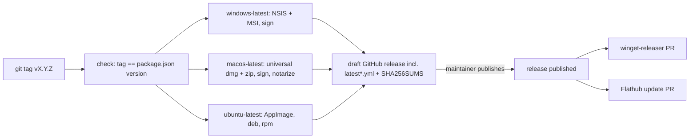
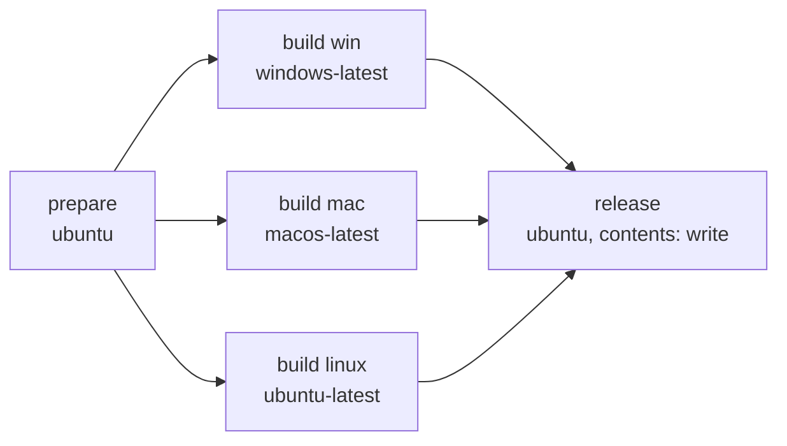

Build and release process: findings and open questions
=============

Status: analysis with improvement proposals (preliminary notes extended).
Date: 2026-10-23

Context
-------------
While fixing #160 and #161 (XSLT changes) it became clear that the build and
release process is largely manual. Several open issues look like symptoms of this.

Findings in the repository
-------------

### Compiled XSLT (`app/xslt/*.sef.json`) is checked in
* `app/main.js` loads only the compiled `.sef.json` files at runtime
  (`cii-xr`, `cio-xr`, `ubl-xr`, `ubl-creditnote-xr`, `xrechnung-html.uni`,
  `ZUGFeRD_1p0_c1p0_s1p0`), never the `.xsl` sources.
* None of the npm scripts (`start`, `build`, `pack`, `publish`) generate them,
  and `xslt3` is not in `package.json`. Contributors must run `xslt3` by hand
  (see `doc/electron.md`, `README.md`) and commit the result.
* Each file is a single minified JSON line (`cii-xr.sef.json` ~6.5 MB,
  `xrechnung-html.uni.sef.json` ~1.3 MB) with a build timestamp, so every change
  produces a huge, unreviewable diff and possible merge conflicts.
* `README.md` notes that `xslt3` on Windows only works in cmd.exe, not PowerShell.
* Existing files were compiled with `xslt3` 2.7 (SaxonJS 2.7); runtime is `saxon-js` 2.4.0.

### No CI
* There is no `.github/workflows` directory.
* `doc/development.md` describes a manual deployment:
  `GH_TOKEN` in a shell, `npm run publish`, then `npm run build` to create the
  `latest*.yml` files and upload them manually to the GitHub release.
* The MSI build needs a manual template patch
  (`cp doc/template.xml node_modules/app-builder-lib/templates/msi`) and a
  `package.json` edit to switch between msi and nsis targets.
* Only a Mac can build all three platforms; otherwise each platform is built
  separately by hand.
* The `build` script is Windows only (`electron-builder build --win`).
* `flatpak/generated-sources.json` exists; Flatpak builds offline from the
  checked-in files, so any build-time XSLT compilation must work there too.

### Published releases are inconsistent
Assets of the last GitHub releases (`gh release view`):

| Release | Windows | macOS | Linux | Update metadata |
|---|---|---|---|---|
| v1.4.2 | `.exe`, `.msi` | universal `.dmg` | `.AppImage` | only `latest.yml` |
| v1.5.0 / v1.5.1 | `.exe`, `.msi` | universal `.dmg` | `.AppImage`, `.snap` | `latest.yml`, `latest-mac.yml`, `latest-linux.yml` |
| 2.0.0 (Latest) | `windows-x64.exe`, `.zip` | `macos-arm64.dmg` | `.deb`, `.rpm`, `.tar.gz` | **none** |

* Tag naming changed from `vX.Y.Z` to `2.0.0`; asset naming changed too, so 2.0.0
  was apparently not built with the electron-builder config in this repository.
* The tag `2.0.0` points to the `master` commit `1362ad4`, but `package.json` there
  still says `1.5.1`. The released binaries cannot be reproduced from the tag.
* electron-updater in 1.5.x installations asks for `latest*.yml` of the latest
  release. 2.0.0 has none, so update checks fail ("update information missing", #140)
  and 1.5.x users are not offered 2.0.
* No MSI (#174), no AppImage, no Intel/universal macOS build in 2.0.0.

### Outdated tooling
* `electron-updater` 5.0.1 together with `electron-builder` 25.1.8; the two should be
  updated together (current electron-builder major is 26/27).
* Flatpak manifest uses runtime/BaseApp `23.08` and `node18`, both end of life.
* `doc/template.xml` was copied into `node_modules` by hand to build the MSI.
  This is lost on every `npm ci` and cannot work in CI without an extra step
  (replaced by a hook, see "MSI customisation").

Related issues
-------------

### Missing or incomplete release artifacts (likely caused by the manual process)
* #89 `latest-linux.yml` missing in release 1.4.2
* #66 update checks broken: `latest-linux.yml` 404 (1.4.0)
* #140 auto-update does not work, "update information missing"
* #164 (closed) AppImage missing in 1.5.1

### Installer and packaging options
* #174 MSI installer wanted for 2.0
* #92 install system wide (terminal servers)
* #95 selectable installer options
* #91 portable version for Windows
* #170 winget does not detect new versions
* Closed, for reference: #53 (silent MSI), #75 (newer Electron), #101/#106 (macOS)

### Signing
* #124 digitally sign Windows executables, DLLs and installers

Ideas to analyse
-------------
1. Generate `.sef.json` at build time (`xslt3` as devDependency, `build:xslt`
   script hooked into `prestart`/`prebuild`/`prepack`), remove them from Git
   and add them to `.gitignore`.
   * Check: start time impact (~6.5 s for the HTML stylesheet alone),
     Flatpak offline build, Windows cmd.exe vs. PowerShell behaviour,
     which `.sef.json` files are generated from which `.xsl`.
2. GitHub Actions release workflow on tag push:
   build all platforms (Windows, macOS, Linux), upload all artifacts including
   `latest.yml`, `latest-mac.yml`, `latest-linux.yml`.
   * Check: would fix #89, #66, #140, #164.
   * Check: secrets handling (`GH_TOKEN`, signing certificate for #124).
3. electron-builder configuration for #174, #92, #95, #91
   (MSI/NSIS options, per-machine install, portable target).
4. winget manifest update as part of the release (#170).

Comparable projects
-------------
Open source Electron apps with electron-builder and an automated GitHub release:

| Project | Workflow | What can be reused |
|---|---|---|
| [marktext](https://github.com/marktext/marktext) | [`release.yml`](https://github.com/marktext/marktext/blob/master/.github/workflows/release.yml), [`build.yml`](https://github.com/marktext/marktext/blob/master/.github/workflows/build.yml) | Tag push `v*`, tag/version check job, OS x arch matrix, artifacts merged in one release job (incl. `latest*.yml`), `SHA256SUMS.txt`, draft release that is published at the end |
| [Zettlr](https://github.com/Zettlr/Zettlr) | [`build.yml`](https://github.com/Zettlr/Zettlr/blob/develop/.github/workflows/build.yml) | One job per OS (Windows, Ubuntu, macOS), signing/notarization only in the Windows/macOS job, final "join" job uploads everything to a draft release |
| [FreeTube](https://github.com/FreeTubeApp/FreeTube) | [`release.yml`](https://github.com/FreeTubeApp/FreeTube/blob/development/.github/workflows/release.yml) | Manual `workflow_dispatch`, each matrix job uploads into the same prepared release |
| [Super Productivity](https://github.com/super-productivity/super-productivity) | [`build.yml`](https://github.com/super-productivity/super-productivity/blob/master/.github/workflows/build.yml), [`flathub-update-on-release.yml`](https://github.com/super-productivity/super-productivity/blob/master/.github/workflows/flathub-update-on-release.yml) | Separate workflows on `release: published` for Flathub, Snap and MS Store, so a store failure does not block the GitHub release; Flathub update PR via `flatpak-external-data-checker` |
| [Logseq](https://github.com/logseq/logseq) | [`build-desktop-release.yml`](https://github.com/logseq/logseq/blob/master/.github/workflows/build-desktop-release.yml) | `workflow_dispatch` inputs (draft, pre-release, publish to Flathub/Snap), compile step before packaging (like XSLT compilation here) |
| [Bitwarden clients](https://github.com/bitwarden/clients) | [`build-desktop.yml`](https://github.com/bitwarden/clients/blob/main/.github/workflows/build-desktop.yml) | Large example with Windows signing via Azure Key Vault in CI |

No other e-invoice/XRechnung viewer with SaxonJS and a public CI pipeline was found.
Compiling `.sef.json` at build time would be done with a plain `xslt3 -export` npm script,
comparable to the compile step in Logseq.

Proposal
-------------

### Target pipeline

1. **Single source of the version.** `package.json` version is the release version,
   tag is `v` + version. A first job fails if they differ. Optional later:
   [release-please](https://github.com/googleapis/release-please) to create the
   version bump PR and changelog.
2. **One workflow, three runners.** `.github/workflows/release.yml` with matrix
   `windows-latest`, `macos-latest`, `ubuntu-latest`; each runs `npm ci`,
   (later) `npm run build:xslt`, `vue-cli-service build` and
   `electron-builder --publish always` for its own platform.
   `permissions: contents: write`, token is the built-in `GITHUB_TOKEN`.
3. **Draft release first.** electron-builder publishes to an existing draft with the
   same version; all three jobs add their assets including `latest.yml`,
   `latest-mac.yml`, `latest-linux.yml`. The maintainer checks the draft and publishes.
   This fixes #89, #66, #140, #164 structurally.
4. **Platform-neutral npm scripts.** Replace `build`/`publish` (`--win` hard coded)
   with e.g. `dist` (`electron-builder`, platform from the runner) and keep
   `pack` for local tests. Targets are defined only in `package.json` `build`.
5. **macOS: `dmg` + `zip`.** electron-updater needs the zip for `latest-mac.yml`;
   universal build on a macOS runner. Secrets: `CSC_LINK`, `CSC_KEY_PASSWORD`,
   `APPLE_ID`, `APPLE_APP_SPECIFIC_PASSWORD`, `APPLE_TEAM_ID`.
6. **Windows: NSIS + MSI in one run.** No more `package.json` edit. The manual
   `doc/template.xml` copy is replaced by the electron-builder hook
   `msiProjectCreated` (see "MSI customisation" below). Set `msi.upgradeCode` once.
   Note: MSI has no electron-updater support, NSIS remains the auto-update path.
   Options for #92, #95, #91: `nsis.perMachine`, `msi.perMachine`, `portable` target.
7. **Signing (#124).** Options: [SignPath Foundation](https://signpath.org/)
   (free certificates for OSS projects, GitHub Actions integration) or
   Azure Trusted Signing (`win.azureSignOptions` in electron-builder ≥ 25.1).
8. **Store/package manager updates after publishing.**
   * winget (#170): [`vedantmgoyal9/winget-releaser`](https://github.com/vedantmgoyal9/winget-releaser)
     on `release: released`, needs a PAT `WINGET_TOKEN`; the package must already exist in winget-pkgs.
   * Flathub: run [`flatpak-external-data-checker`](https://github.com/flathub-infra/flatpak-external-data-checker)
     on release as in Super Productivity, or rely on Flathub's own checker.
9. **CI on pull requests.** A light `build.yml` (`npm ci`, Vue build,
   `electron-builder --dir`) on PRs catches missing files/dependencies before a release.

### Suggested order
1. Fix the 2.0 state: publish `latest.yml`, `latest-mac.yml`, `latest-linux.yml`
   for 2.0.0 (or a 2.0.1 built from this repo) and set `package.json` to the released version.
2. Platform-neutral npm scripts + `release.yml` with draft release (unsigned at first).
3. Update electron-builder and electron-updater together, macOS `zip` target, MSI without manual patch.
4. Build-time XSLT compilation (idea 1 above).
5. Signing, winget and Flathub automation; Flatpak runtime update (24.08, node20).

Technical design
-------------
Implemented in [`.github/workflows/release.yml`](../.github/workflows/release.yml)
(step 2 of the suggested order). Tested in the fork `duichwer/quba-viewer`.

### Goals and non-goals
* Goals: reproducible release from a Git tag, all platforms in one run, complete
  update metadata, nothing published without a manual check, no change to the app
  code or the electron-builder config in `package.json`.
* Not yet: Windows signing, XSLT compilation at build time, winget/Flathub automation,
  dependency updates. These are separate follow-up PRs.

### Versioning and tags
* `package.json` `version` is the single source of truth.
* Release tag is `v` + version (`v2.0.1`). This is the old convention up to v1.5.1
  and what electron-updater expects from the GitHub provider.
* A version with a suffix (`2.1.0-beta.1`) becomes a GitHub pre-release.
  electron-updater ignores pre-releases unless `autoUpdater.allowPrerelease` is set,
  so beta builds do not reach normal users.

### Triggers
| Event | Build | Release |
|---|---|---|
| Push of tag `v*` | all platforms | draft release `<tag>`; fails if tag ≠ `v` + `package.json` version |
| `workflow_dispatch` (Actions tab, needs the workflow on the default branch) | all platforms | draft pre-release `v<version>-ci.<run number>` |
| Pull request | all platforms | none (build check only) |

### Jobs

1. **prepare**: reads the version, checks the tag, computes release tag and
   pre-release flag.
2. **build** (matrix, `fail-fast: false`): `npm ci` → `vue-cli-service build` →
   `electron-builder <targets> --publish never` → upload `release/*` as artifact.
   electron-builder never talks to GitHub here; it only writes files.
   Windows artifact names are set explicitly without spaces (`nsis.artifactName`,
   `msi.artifactName`): the default `Quba Setup X.exe` is renamed by GitHub to
   `Quba.Setup.X.exe`, while `latest.yml` refers to `Quba-Setup-X.exe`, so the
   Windows update download returned 404 (seen in the first fork test run and in
   the v1.4.2–v1.5.1 assets).

   | Runner | Targets | Files |
   |---|---|---|
   | `windows-latest` | `nsis msi --x64` | `Quba-Setup-X.exe`, `.blockmap`, `Quba-X.msi`, `latest.yml` |
   | `macos-latest` | `dmg zip --universal` | `Quba-X-universal.dmg`, `-mac.zip`, `.blockmap`s, `latest-mac.yml` |
   | `ubuntu-latest` | `AppImage --x64` | `Quba-X.AppImage`, `latest-linux.yml` |

   The zip on macOS is required because electron-updater (Squirrel.Mac) updates
   from the zip, not the dmg. deb/rpm/snap are left out: deb/rpm need an author
   e-mail and `rpmbuild`, snap needs `snapcraft`; they can be added later.
3. **release**: downloads all artifacts, **fails if one of `latest.yml`,
   `latest-mac.yml`, `latest-linux.yml` is missing, if a file referenced there was
   not built, or if an asset name contains spaces**, writes `SHA256SUMS.txt`,
   creates the draft release with `gh release create --draft --generate-notes`
   (or replaces assets on re-run with `gh release upload --clobber`).
   Only this job has `contents: write`; the build jobs run read-only.

Collecting everything in one job (as Zettlr and marktext do) avoids the race when
three electron-builder processes try to create the same GitHub release, and makes
"missing `latest*.yml`" a build failure instead of a silent gap.

### Secrets
| Secret | Used for | Without it |
|---|---|---|
| `GITHUB_TOKEN` (automatic) | creating the draft release | – |
| `MAC_CSC_LINK`, `MAC_CSC_KEY_PASSWORD` | Developer ID certificate (base64 `.p12`) | unsigned dmg/zip, warning in the log; macOS auto-update does not work unsigned |
| `APPLE_ID`, `APPLE_APP_SPECIFIC_PASSWORD`, `APPLE_TEAM_ID` | notarization | not notarized |
| later: SignPath or Azure Trusted Signing credentials | Windows signing (#124) | unsigned exe/msi (SmartScreen warning) |

Secrets are not passed to workflows triggered from forks' pull requests, so PR
builds are always unsigned.

### Maintainer release process
1. PR that bumps `version` in `package.json` (e.g. `2.0.1`), merge to `master`.
2. `git tag v2.0.1 && git push origin v2.0.1`.
3. Wait for the workflow (≈ 10–15 min), open the draft release, check the assets
   and the generated notes, test an installer.
4. Publish the release. From this moment electron-updater in installed versions
   sees the new `latest*.yml`.

### Costs
GitHub-hosted runners (including macOS) are free and unlimited for public
repositories, so neither `ZUGFeRD/quba-viewer` nor a public fork pays anything.
Private repositories get a monthly quota of free minutes (2 000 on GitHub Free),
macOS minutes count ×10.
See [About billing for GitHub Actions](https://docs.github.com/en/billing/managing-billing-for-your-products/managing-billing-for-github-actions/about-billing-for-github-actions).
Artifacts are kept 90 days by default.

### MSI customisation
`doc/template.xml` was a full copy of electron-builder's internal WiX template that had
to be copied into `node_modules` by hand. Compared with the bundled template of
electron-builder 25.1.8 its only functional addition was the `AUTOUPDATE` property
written to `AppConfig.ini` (read by `readInstallerConfigAndPerformAutoUpdate()` in
`app/main.js`); everything else was whitespace.

It is replaced by [`scripts/msi-project-created.js`](../scripts/msi-project-created.js),
registered as `build.msiProjectCreated` in `package.json`. electron-builder calls this
documented hook with the generated `project.wxs` before running WiX; the hook appends
the property and an `IniFile` component. Advantages:
* no file in `node_modules` is overwritten, `npm ci` and electron-builder updates keep working;
* electron-builder's own template changes (fixes, new options) are no longer lost;
* it depends only on the WiX ids `APPLICATIONFOLDER` and `ProductFeature` and stops
  the build with a clear error if they disappear;
* `AppConfig.ini` is written to the folder the user actually chose (the old template
  used a fixed default path), and `AUTOUPDATE` is `Secure`, so it is also passed
  through for per-machine installations.

### Risks and limits
* `macos-latest` is arm64; the universal build combines x64 and arm64 there.
* 2.0.0 was released outside this pipeline. The first pipeline release should be
  2.0.1 (or later) from a `master` that contains the 2.0 code.

Documentation
-------------
* electron-builder publish / GitHub releases: https://www.electron.build/docs/publish
* electron-builder multi platform build and CI: https://www.electron.build/docs/features/multi-platform-build
* Auto update (`latest*.yml`, which targets support it): https://www.electron.build/docs/features/auto-update
* Code signing Windows / macOS: https://www.electron.build/docs/features/code-signing/code-signing-win,
  https://www.electron.build/docs/features/code-signing/code-signing-mac
* MSI and NSIS options: https://www.electron.build/docs/msi, https://www.electron.build/docs/nsis
* GitHub Actions `GITHUB_TOKEN` permissions:
  https://docs.github.com/actions/security-for-github-actions/security-guides/automatic-token-authentication
* Electron release/distribution overview: https://www.electronjs.org/docs/latest/tutorial/tutorial-packaging
* Electron Forge (alternative to electron-builder, not recommended here because of
  the existing config): https://www.electronforge.io/config/publishers
* winget releaser: https://github.com/vedantmgoyal9/winget-releaser
* Flatpak node generator: https://github.com/flatpak/flatpak-builder-tools/tree/master/node
* Flathub maintenance / external data checker: https://docs.flathub.org/docs/for-app-authors/maintenance
* SaxonJS `xslt3 -export` (SEF compilation): https://www.saxonica.com/saxonjs/documentation2/index.html#!starting/export

Open questions for the maintainer
-------------
* How was 2.0.0 built (repository, tool chain), and should it be rebuilt from this repo?
* Is a CI based release acceptable, and who owns the signing certificate?
* Can `.sef.json` files be removed from Git, given the Flatpak build?
* Should MSI stay a supported target in 2.0 (#174)?
